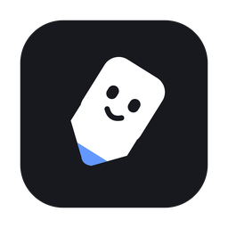
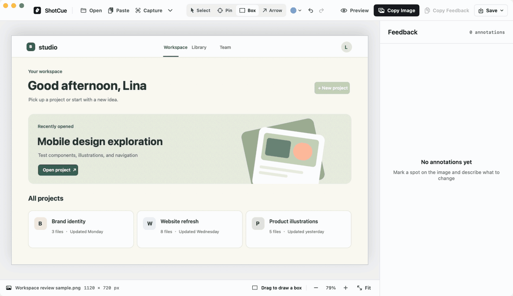

<p align="center">
  
</p>
<h1 align="center">ShotCue</h1>
<p align="center">Screenshot feedback for working with AI agents</p>
<p align="center"><a href="README.md">简体中文</a> · English</p>

Mark the part of a screenshot that needs work, describe the issue and the requested change, then paste the image with numbered annotations and feedback into your agent chat.



## Download and install

[Download ShotCue](https://github.com/howardz27/shotcue/releases/latest/download/ShotCue-macOS-arm64.zip)

The current download supports Apple Silicon Macs running macOS 14 or later. Unzip the download, drag `ShotCue.app` into Applications, and open it. Choose **English** or **简体中文** (Simplified Chinese) on the first screen.

The download uses ad hoc signing and has not been notarized by Apple. If macOS blocks the first launch, confirm that the archive came from this repository's Releases page before selecting **Open Anyway** in **System Settings → Privacy & Security**. [Apple's instructions](https://support.apple.com/en-us/102445)

For screen capture, grant Screen Recording access in System Settings if prompted.

## Features

- **Import and capture.** Open, drop, or paste an image, or capture a region of the screen. ShotCue can hide its window while you capture.
- **Numbered annotations.** Use boxes, pins, or arrows. Type your feedback right after adding an annotation, press Tab to switch from the issue to the requested change, or press Esc to return to the canvas.
- **Select and adjust.** Click or drag to select annotations. Move them together, or use the handles on a single annotation to resize a box or adjust an arrow.
- **Custom colors.** Pick a preset, drag in the color picker, or enter a hex value.
- **Share with an agent.** Preview, copy, or save an annotated PNG, or copy Markdown feedback with coordinates from the original image. When you've entered feedback, the PNG includes it below the screenshot. With empty notes, the export keeps the original dimensions and places the annotations on the image.
- **Switch languages.** Click **Language** (or **语言**) next to the ShotCue logo at the top of the window. The choice takes effect immediately, is remembered, and applies to the labels in exported feedback.

ShotCue works offline and keeps your most recent review as a local draft.

### Keyboard shortcuts

| Action | Shortcut |
| --- | --- |
| Open an image | `⌘O` |
| Paste an image while editing text | `⌘⌥V` |
| Capture a screen region | `⌘⇧S` |
| Pin, box, or arrow | `1` / `2` / `3` |
| Select tool | `V` |
| Select every annotation | `Ctrl+A` / `⌘A` |
| Pan / Fit to window | Hold Space and drag / `0` |
| Preview PNG | `⌘Y` |
| Copy image | `⌘⌥C` |
| Copy feedback | `⌘⇧C` |
| Save PNG | `⌘S` |
| Undo / Redo | `⌘Z` / `⌘⇧Z` |

## Build from source

Requires Swift 5.9 or later and Xcode or the Command Line Tools.

```sh
./scripts/build-app.sh
open dist/ShotCue.app
```

Run the bundled checks for PNG export, clipboard support, undo and redo, draft recovery, and language preferences.

```sh
"dist/ShotCue.app/Contents/MacOS/FrameNote" --self-test "$(mktemp -d)"
```

## License

ShotCue is available under the [MIT License](LICENSE).
